# Task 1: Kubernetes Multi-Container Pod

This task deploys a time-changing Nginx page to a three-node Minikube cluster. The
Deployment runs three replicas, uses an init container, and uses a BusyBox sidecar
to update the page every five seconds without a shared volume.

## Files

- [`deployment.yaml`](./deployment.yaml): Kubernetes Deployment manifest.
- [`answer.txt`](./answer.txt): Answers to the failed-init questions.
- [`screenshots/`](./screenshots/): Command output and verification evidence.

## Architecture

The `web-deployment` Deployment runs three Pods in the `webapp` namespace:

| Container | Image | Purpose |
|---|---|---|
| Init container | `busybox:1.36` | Prints `done`; the Pod cannot start its application containers until it succeeds. |
| `nginx` | `nginx:1.27` | Writes the initial HTML page and serves it on port 80. |
| `time-updater` | `busybox:1.36` | Finds the Nginx process and rewrites `index.html` every five seconds. |

The Pod sets `shareProcessNamespace: true`. The sidecar can therefore see the
Nginx process and writes into the Nginx root through `/proc/<nginx-pid>/root`.
The manifest does not define application volumes.

> **Manifest and screenshot naming:** The supplied manifest names the init
> container `init-myservice`, while the task instructions and captured terminal
> output refer to it as `init-done`. The behavior is the same; use the name in
> the manifest when running commands against the current YAML.

## Deployment

The cluster was configured with one control-plane node and one worker node shown
in the captured node output. The `webapp` namespace was used for the workload.

```bash
kubectl apply -f deployment.yaml
kubectl get pods -n webapp -w
kubectl get deploy web-deployment -n webapp
```

The Deployment reached `3/3` ready replicas, with each Pod reporting `2/2
Running` after the init container completed:

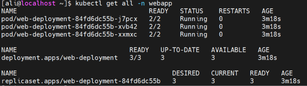

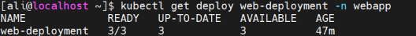

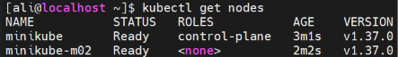

## Application access and time updates

The application was exposed locally with port forwarding:

```bash
kubectl port-forward --address 0.0.0.0 \
  pod/web-deployment-797f96864b-tnhjg 8080:80 -n webapp
```

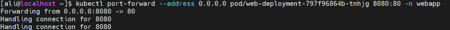

The HTML content changed between two reads several seconds apart, confirming
that the sidecar updates the page:

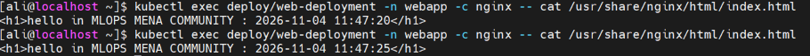

## Verification

All verification checks from the task are included below.

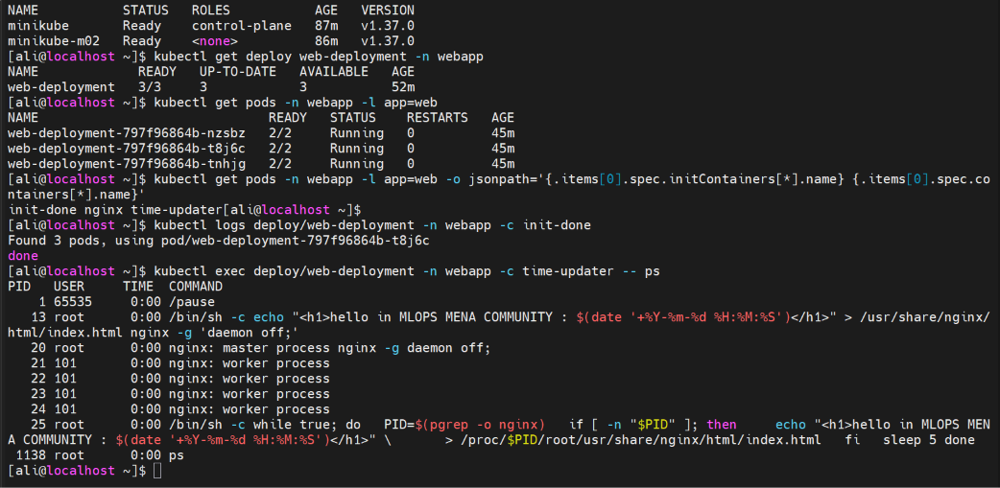

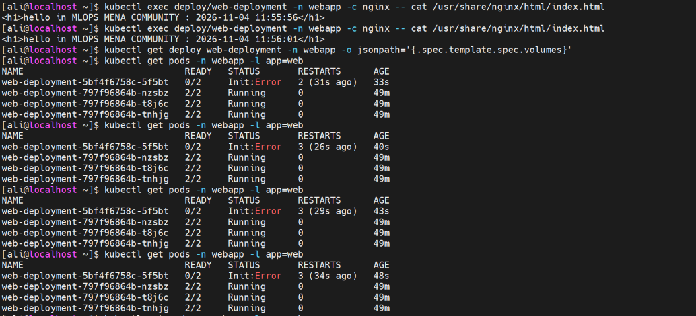

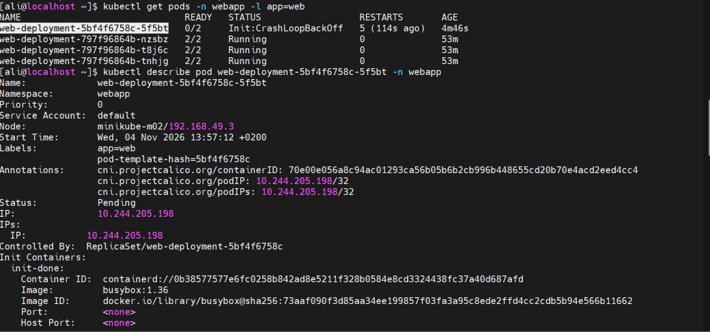

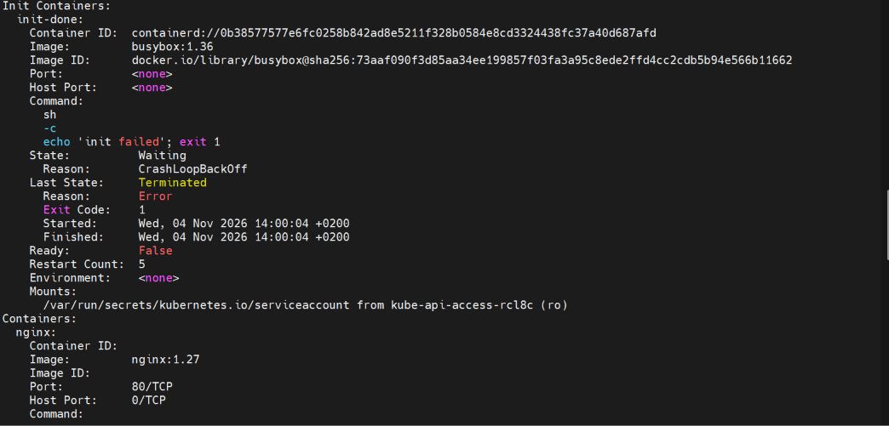

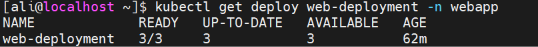

## Failed init-container test

The init command was changed to:

```yaml
command: ["sh", "-c", "echo 'init failed'; exit 1"]
```

After applying the change, the replacement Pod entered `Init:Error` and then
`Init:CrashLoopBackOff`, with `0/2` ready containers. The captured logs showed
`init failed`, and the description showed exit code `1`:

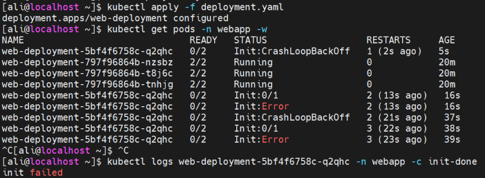


### Answers

the new pod shows status of error and after certain number of failed starts the status changes to CrashLoopBackOff.

nginx and time-updater do not start in the new pod and the page is still reachabe.

nginx and time-updater do not start because the init container are required to run successfully before the main containers work (as a precondition)

the page is still reachable beacause k8s didnt shutdown the old pods or descale the old replicaset, it only does that when the new pod is created and running successfully

These answers are also recorded in [`answer.txt`](./answer.txt).
