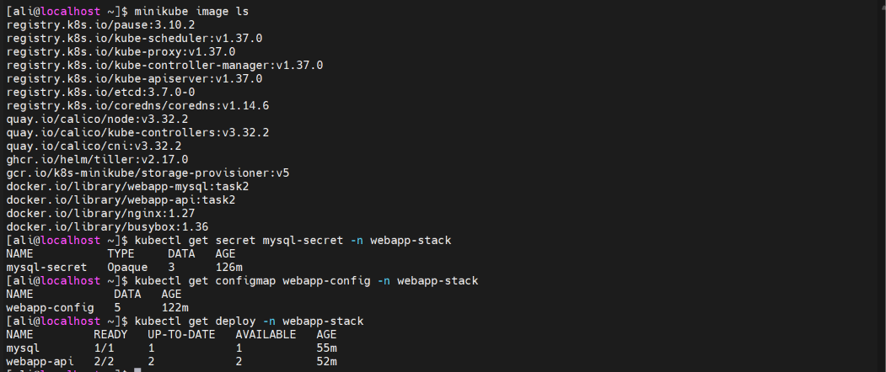
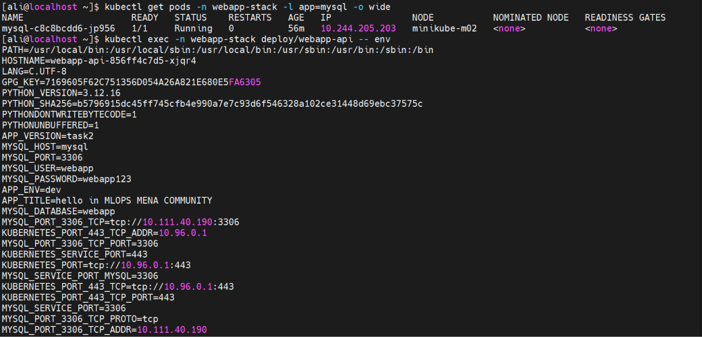
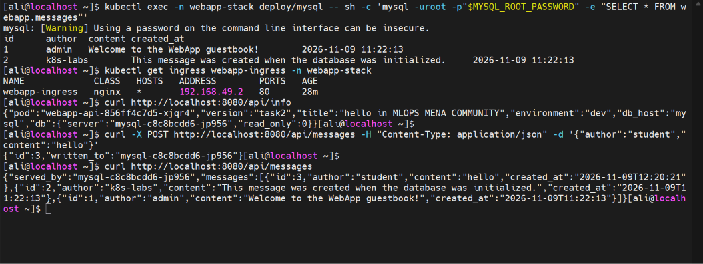
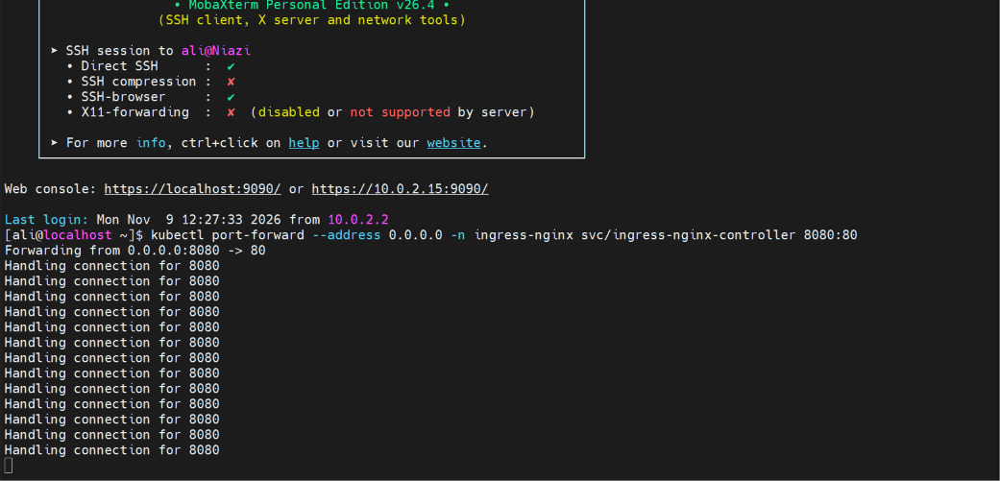
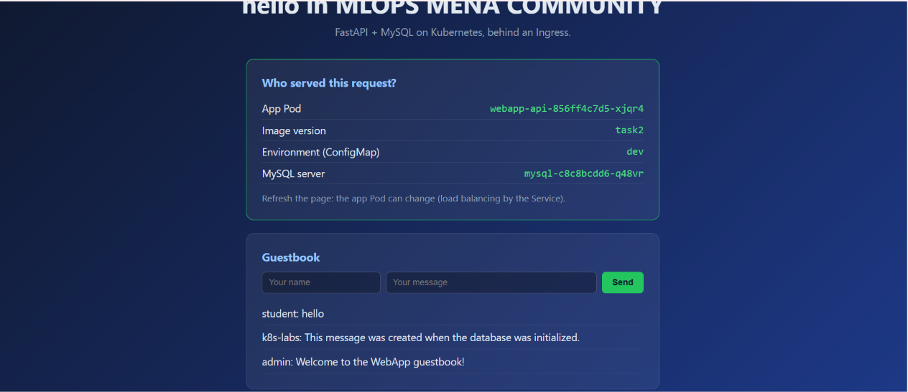
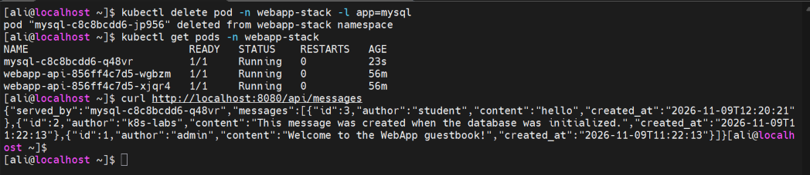

# Task 2: FastAPI and MySQL on Kubernetes

> **Resource constraint note:** This task was completed using two Minikube nodes
> instead of the planned three nodes because of available system resources.

This task deploys a FastAPI guestbook application backed by MySQL. Kubernetes
resources provide configuration, credentials, persistent storage, health checks,
and external access through an Nginx Ingress.

## Files

- [`webapp-deployment.yaml`](./webapp-deployment.yaml): FastAPI Deployment.
- [`webapp-service.yaml`](./webapp-service.yaml): ClusterIP Service for the API.
- [`webapp-config.yaml`](./webapp-config.yaml): Application ConfigMap.
- [`mysql-deployment.yaml`](./mysql-deployment.yaml): MySQL Deployment.
- [`mysql-service.yaml`](./mysql-service.yaml): MySQL ClusterIP Service.
- [`mysql-secret.yaml`](./mysql-secret.yaml): MySQL and application credentials.
- [`mysql-pv.yaml`](./mysql-pv.yaml) and [`mysql-pvc.yaml`](./mysql-pvc.yaml):
  persistent storage.
- [`webapp-ingress.yaml`](./webapp-ingress.yaml): Nginx Ingress route.
- [`screenshots/`](./screenshots/): Command output and application evidence.

## Architecture

The request path is:

```text
Browser -> Nginx Ingress -> webapp-api Service -> FastAPI Pods
                                      |
                                      v
                               mysql Service -> MySQL Pod
                                                    |
                                                    v
                                                mysql-pvc
```

The stack uses:

| Resource | Configuration |
|---|---|
| Namespace | `webapp-stack` |
| API Deployment | `webapp-api`, 2 replicas, port 8000 |
| MySQL Deployment | `mysql`, 1 replica, `Recreate` strategy |
| API Service | `webapp-api`, port 80 to target port 8000 |
| MySQL Service | `mysql`, port 3306 |
| ConfigMap | `webapp-config` |
| Secret | `mysql-secret` |
| Storage | `mysql-pv` and `mysql-pvc`, 2 GiB |
| Ingress | `webapp-ingress`, class `nginx` |

The MySQL PersistentVolume uses `/data/webapp-mysql` and is pinned to
`minikube-m02` using node affinity. This keeps the Pod on the node where the
`hostPath` data exists.

## Configuration and security

The ConfigMap supplies:

- `APP_TITLE`
- `APP_ENV`
- `MYSQL_HOST`
- `MYSQL_PORT`
- `MYSQL_DATABASE`

The Secret supplies the MySQL root password, application username, and
application password. The API receives the application credentials through
`secretKeyRef`, while MySQL receives its initialization credentials the same
way.

The API uses `/health` for both readiness and liveness probes. MySQL uses
`mysqladmin ping` for its readiness and liveness probes.

## Deployment

The locally built images were loaded into Minikube and used with
`imagePullPolicy: IfNotPresent`:

```bash
docker build -t webapp-api:task2 ./webapp
docker build -t webapp-mysql:task2 ./mysql
minikube image load webapp-api:task2
minikube image load webapp-mysql:task2
minikube image ls
```

The namespace, Secret, ConfigMap, PV, PVC, Services, Deployments, and Ingress
were then applied. The captured output shows the expected images, Secret,
ConfigMap, and ready Deployments:



The final workload contains one ready MySQL Pod and two ready API Pods.
The MySQL Pod is scheduled on `minikube-m02`, the node selected by the PV
affinity:



The API Pod output confirms the ConfigMap and Secret values were injected,
including `APP_VERSION=task2`, `APP_ENV=dev`, `MYSQL_HOST=mysql`, and the
database connection settings.

## Database and API verification

The MySQL query returned the two default guestbook messages created during
database initialization. The Ingress was available at `192.168.49.2`:

```bash
kubectl exec -n webapp-stack deploy/mysql -- sh -c \
  'mysql -uroot -p"$MYSQL_ROOT_PASSWORD" -e "SELECT * FROM webapp.messages"'
kubectl get ingress webapp-ingress -n webapp-stack
```

The API information endpoint confirmed the application version, title,
environment, and MySQL server. A POST request added a new message, and a
subsequent GET returned the new message together with the existing messages:



## Ingress and application

The Ingress Controller Service was forwarded to local port 8080:

```bash
kubectl port-forward --address 0.0.0.0 \
  -n ingress-nginx svc/ingress-nginx-controller 8080:80
```



Opening `http://localhost:8080` displayed the FastAPI guestbook. The page
showed the serving API Pod, image version `task2`, `dev` environment, MySQL
server, and the stored guestbook messages:



## Persistence verification

The MySQL Pod was deleted to simulate a restart:

```bash
kubectl delete pod -n webapp-stack -l app=mysql
kubectl get pods -n webapp-stack
curl http://localhost:8080/api/messages
```

Kubernetes recreated the MySQL Pod, and the API still returned the previously
stored message. This confirms that the MySQL data was preserved by the
PersistentVolume and PersistentVolumeClaim:


