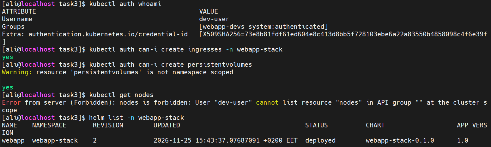
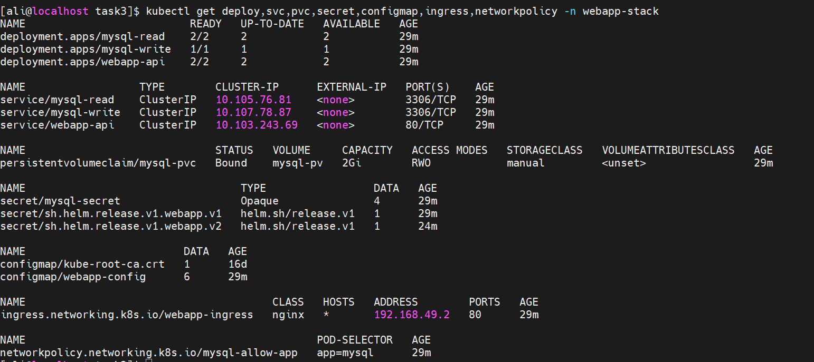
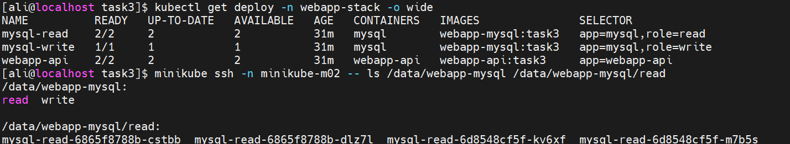
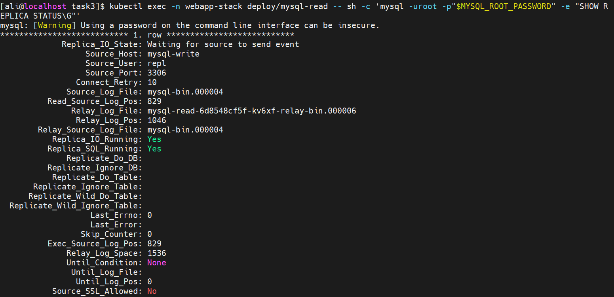
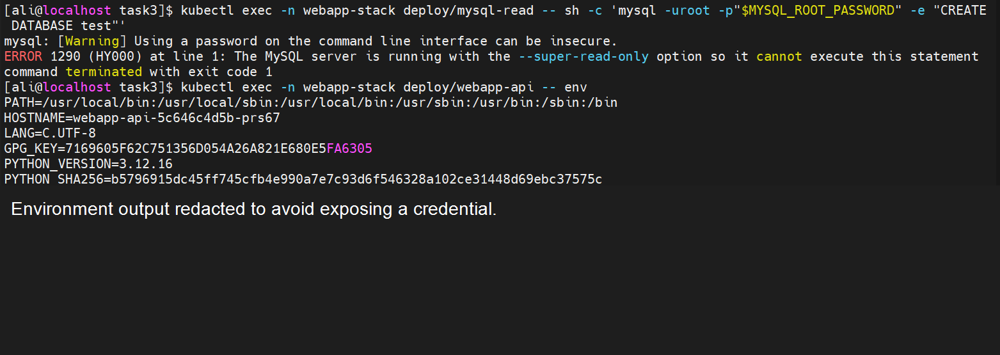
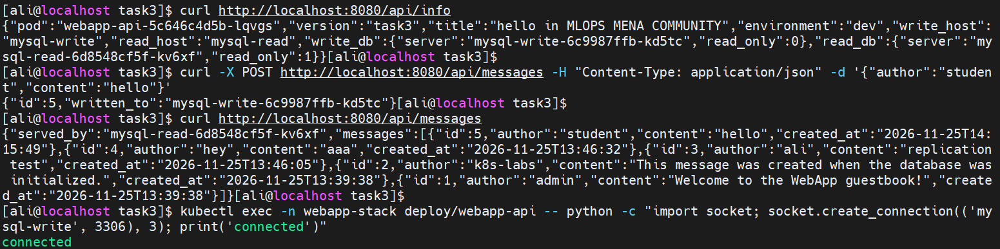
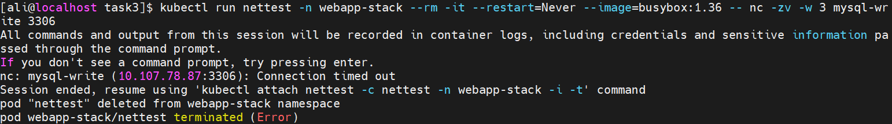
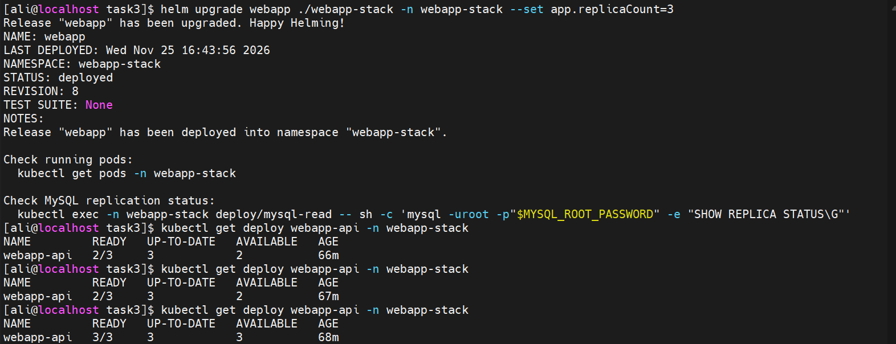

# Task 3: MySQL Read Replicas, RBAC, NetworkPolicy, and Helm

> **Resource constraint note:** This task was completed using a two-node
> Minikube cluster due to limited system resources.

This task extends the Kubernetes web application with separate MySQL write and
read services, MySQL replication, a restricted `dev-user`, ingress filtering,
and a Helm chart to install the application stack.

## Deployed stack

The Helm release `webapp` was installed in the `webapp-stack` namespace. It
contains:

- `webapp-api`, initially running two replicas, with configuration that sends
  writes to `mysql-write` and reads to `mysql-read`.
- `mysql-write`, a single MySQL source server.
- `mysql-read`, two read-only MySQL replicas that replicate from `mysql-write`.
- A 2 GiB PersistentVolume and PersistentVolumeClaim. The write server uses its
  own data directory, and each read Pod has a separate directory on the
  `minikube-m02` node.
- Services, a ConfigMap, a Secret, and an Ingress for the app and database.
- A NetworkPolicy that allows MySQL port 3306 traffic from the app and the
  MySQL Pods, supporting application access and replication.
- Namespace-scoped RBAC for `dev-user`, plus cluster-scoped permission to
  manage PersistentVolumes.

The chart's default values specify two API replicas, one write replica, two read
replicas, and 2 GiB PV/PVC sizes. During final verification, the API was scaled
to three replicas through a Helm upgrade.

## Key files

- [`webapp-stack/`](./webapp-stack/): Helm chart and Kubernetes resource
  templates.
- [`webapp-stack/values.yaml`](./webapp-stack/values.yaml): image, replica, and
  storage defaults.
- [`rbac.yaml`](./rbac.yaml): namespace Role/RoleBinding and PV ClusterRole/
  ClusterRoleBinding.
- [`mysql-networkpolicy.yaml`](./mysql-networkpolicy.yaml): MySQL ingress
  restrictions.
- [`mysql-pv.yaml`](./mysql-pv.yaml) and [`mysql-pvc.yaml`](./mysql-pvc.yaml):
  persistent storage configuration.
- [`webapp-config.yaml`](./webapp-config.yaml): app title, environment, and
  separate MySQL read/write addresses.

## Helm and application checks

The chart can be checked and rendered before installation:

```bash
helm lint ./webapp-stack
helm template webapp ./webapp-stack -n webapp-stack
```

Install the chart using the `dev-user` context:

```bash
kubectl config use-context dev-user@k8s-lab
helm upgrade --install webapp ./webapp-stack -n webapp-stack
helm list -n webapp-stack
```

The API was later scaled to three replicas with a Helm upgrade:

```bash
helm upgrade webapp ./webapp-stack -n webapp-stack --set app.replicaCount=3
kubectl get deploy webapp-api -n webapp-stack
```

To access the Ingress locally, use the admin context to forward the ingress
controller, then check the API and its message endpoints:

```bash
kubectl --context minikube port-forward -n ingress-nginx \
  svc/ingress-nginx-controller 8080:80

curl http://localhost:8080/api/info
curl -X POST http://localhost:8080/api/messages \
  -H "Content-Type: application/json" \
  -d '{"author":"student","content":"hello"}'
curl http://localhost:8080/api/messages
```

The API response showed version `task3`, with writes going to the write server
and reads served by a replica. The MySQL replica status reported both replication
threads running, and an attempted database creation on a replica was rejected
because it is configured as read-only.

The captured RBAC checks also confirmed that `dev-user` can create resources
within the task namespace and manage PersistentVolumes, but cannot list cluster
nodes.

## Verification screenshots

















> **Credential safety:** Keep `dev-user.key` and any files containing database
> credentials out of public Git repositories. The original `verify5.png` is
> left unchanged; the README uses a redacted copy because the original includes
> credential-bearing environment output.
